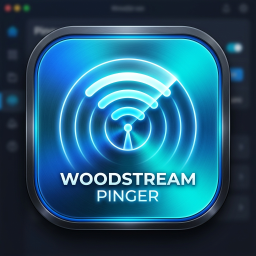

# WoodStream Pinger

C#、.NET 10、および WinUI 3 (Windows App SDK) で構築された、複数ホストへの並行 Ping 実行・リアルタイム統計可視化 GUI ツールです。



---

## 主な機能

1. **複数ホストへの並行 Ping 実行**
   - 複数のホスト名または IP アドレスを一括登録（改行・カンマ区切り対応）
   - 全ホスト一括開始 / 一括停止
   - ホストごとの個別開始 / 個別停止 / 統計リセット / 削除
   - UI スレッドをブロックしない完全非同期・並行ループ処理 (`async/await`, `Task.Run`)

2. **Ping 各種パラメータの動的変更 (Expander)**
   - タイムアウト時間 (ms)
   - 送信インターバル (ms)
   - パケットバッファサイズ (1〜65500 Bytes)
   - 生存可能時間 (TTL: 1〜255)
   - フラグメント禁止 (Don't Fragment)
   - 試行回数 (0 = 手動停止までの継続ループ)

3. **リアルタイム統計・可視化**
   - 各ホストの最新ステータス（OK / Timeout / Unreachable / Error）バッジ表示
   - 最新応答時間 (Last RTT)
   - 送信パケット数 (Sent)、受信パケット数 (Received)、損失数・損失率 (Lost / Loss %)
   - 最小応答時間 (Min RTT)、最大応答時間 (Max RTT)、平均応答時間 (Avg RTT)
   - 下部ステータスバーによる全体サマリー集計（稼働数、総送信、総損失率、全体平均RTT）

4. **統計結果の CSV エクスポート**
   - ワンクリックで全ホストの統計データを CSV ファイルとして保存
   - Excel で直接開いた際の文字化けを防ぐ BOM 付き UTF-8 形式

5. **テーマ対応 (ライト / ダークモード)**
   - Windows OS のシステムテーマ設定変更を自動検知して連動
   - アプリ内から「システムに従う」「ライト」「ダーク」を手動即時切り替え可能

6. **多言語対応 (日本語 / 英語)**
   - Windows の表示言語モード（UI Culture）を自動検知して初期選択
   - アプリ内から「自動」「日本語」「英語」を即時切り替え可能

7. **状態の自動復元**
   - 終了時のウィンドウ位置、サイズ、最大化状態を次回起動時に正確に復元
   - 登録ホストリストや Ping パラメータを `AppData\Local\WoodStreamPinger\settings.json` に安全に永続化

---

## 開発環境・必要要件

- **OS**: Windows 10 (バージョン 1809 / ビルド 17763) 以降、Windows 11
- **ランタイム**: .NET 10 SDK (`10.0.x`)
- **Windows App SDK**: 2.4.x (WinUI 3)
- **MVVM**: CommunityToolkit.Mvvm 8.4.x

---

## ビルド手順

### 開発用ビルド & デバッグ実行
```powershell
# プロジェクトのビルド
dotnet build

# アプリケーションの起動
dotnet run
```

### スタンドアロンインストーラ (.exe) の作成
実行環境アーキテクチャ（x64 等）に合わせた自己完結型（Self-Contained）のインストーラを作成します。
```powershell
pwsh -File .\build-installer.ps1 -Architecture x64
```
生成されたインストーラは `.\Installer` フォルダに出力されます（例: `WoodStreamPinger_Setup_v1.0.0.0_x64.exe`）。

---

## ライセンス

本ソフトウェアは MIT ライセンスのもとで公開されています。
